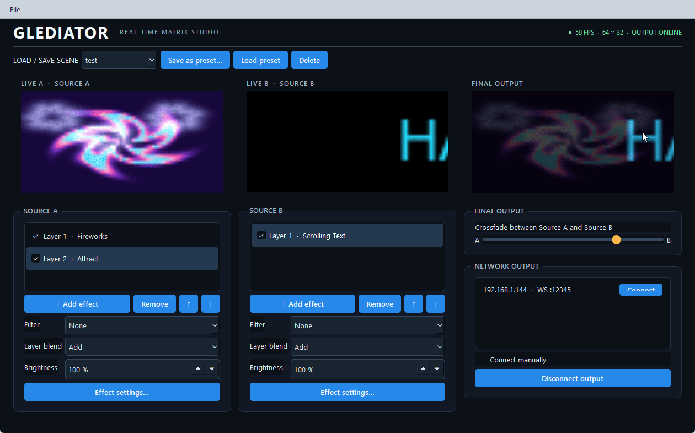

# Glediator Python / Qt6 rebuild

This is a fresh Python implementation of the Glediator LED-matrix visualizer. It keeps an isolated NumPy rendering core, five-layer scenes, common generator/filter/mixer components, a two-live-source crossfader, and a three-preview Qt6 studio UI. The workspace columns are Source A, Source B and Final Output; each source's live preview sits above its effect list and controls. Use **Add effect** and double-click an effect in the picker to add it. 

A standalone Arduino receiver sketch using the HUB75 DMA library is in [`esp32-firmware`](esp32-firmware/README.md).



## Run

Requires Python 3.10 or newer. From this directory:

```powershell
py -m venv .venv
.venv\Scripts\activate
python -m pip install -e .
python main.py
```

Settings are persisted in `%USERPROFILE%\.glediator\settings.json` (matrix size, target FPS, mapping, WebSocket destination, live sources and named presets). The default matrix is 64×32. Use **File → LED Panel Config** to change matrix dimensions and pixel order. Preview cards maintain the matrix aspect ratio and fill the preview image area without letterbox bars. Use the **Scene Manager** bar to save/load named presets for both sources and the crossfade/mixed output. **File → Save Settings** writes all current settings and live scene configuration.

Each source's **Effect settings** opens effect-specific parameters. Wave includes position, amplitude, frequency, thickness, palette and editable colors. Random Pixel exposes spawn rate, fade duration and palette. Shared palette presets—Aurora, Fire, Ocean, Sunset, Neon, Rainbow, Candy and Monochrome—are available to compatible effects. Meta Balls count now changes the number of independently positioned blobs, while radius is a separate parameter. The former Expanding Objects effect is now **Expanding Circles** (older saved projects are migrated).

Scrolling Text offers a selectable font, font size, direction and speed. Screen Capture offers monitor selection and region coordinates; it uses `mss` to convert the selected desktop region to the matrix dimensions, and reports capture errors in the status bar instead of silently hiding them. Regular Windows desktop capture does not normally require a special permission prompt; protected DRM video, the UAC secure desktop, a locked session, remote-desktop restrictions, or invalid monitor/region coordinates can still produce a black frame. The `mss` backend was verified capturing the current desktop.

The generator list also includes NumPy/Qt-independent visual adaptations of the 28 named AuroraDemo patterns (`Attract`, `Bounce`, `Cube`, `Electric Mandala`, `FireKoz`, `Fireworks`, `Flock`, `Flow Field`, `Green Scroll`, `Incremental Drift`, `Incremental Drift 2`, `Infinity`, `Julia Set Fractal`, `Maze`, `Munch`, `Noise Smearing`, `Pendulum Wave`, `Aurora Plasma`, `Radar`, `Aurora Rain`, `Simplex Noise`, `Snake`, `Spin`, `Spiral`, `Spiro`, `Starfield`, `Test`, `Aurora Wave`). These are fresh vectorized implementations inspired by the pattern behavior and names in the upstream [ESP32-HUB75-MatrixPanel-DMA AuroraDemo](https://github.com/mrcodetastic/ESP32-HUB75-MatrixPanel-DMA/tree/master/examples/AuroraDemo), not a line-by-line C++ port.

VU Meter and Simple Spectrum capture local audio on demand. **System Output** uses the default playback device's loopback capture; **Microphone** uses the default recording input. They use SoundCard on a background thread and show an error in the status bar if loopback or input capture is unavailable. System-output loopback support depends on the OS/audio backend and may require enabling the device's loopback/monitor source.

## WebSocket output

The Final Output column has a separate **Network Output** box below the crossfade. At startup it listens for UDP datagrams containing `CODETASTIC` on port 20586; discovered sender IPs appear with a Connect button. The WebSocket destination port defaults to 12345. **Connect manually** reveals host/IP and numeric port inputs when discovery is unavailable. The app must be allowed through the local firewall to receive LAN broadcasts. Every WebSocket binary message is one complete frame: the two-byte start marker `81 81`, followed by all mapped RGB565 pixels as two-byte big-endian color values. No legacy UDP fragmentation header is sent over WebSocket.

## Core layout

- `glediator/core`: frame representation, scenes, pipeline, fader, scene collection and render thread; no Qt imports.
- `glediator/generators`: NumPy procedural generator registry.
- `glediator/mapper`: horizontal/vertical line and snake pixel orders.
- `glediator/output`: bounded-queue MrCodetastic WebSocket output.
- `glediator/ui`: PySide6 main window and live frame previews.

Run core tests with `python -m pytest`.
